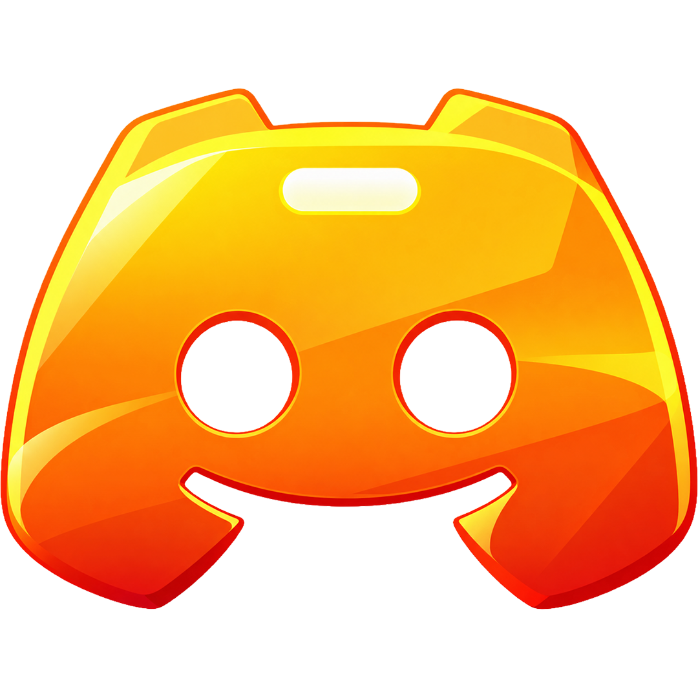
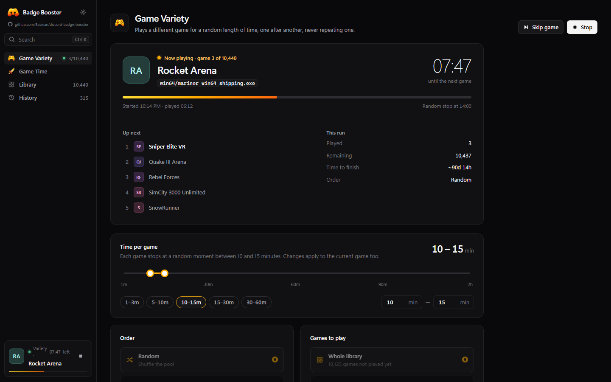
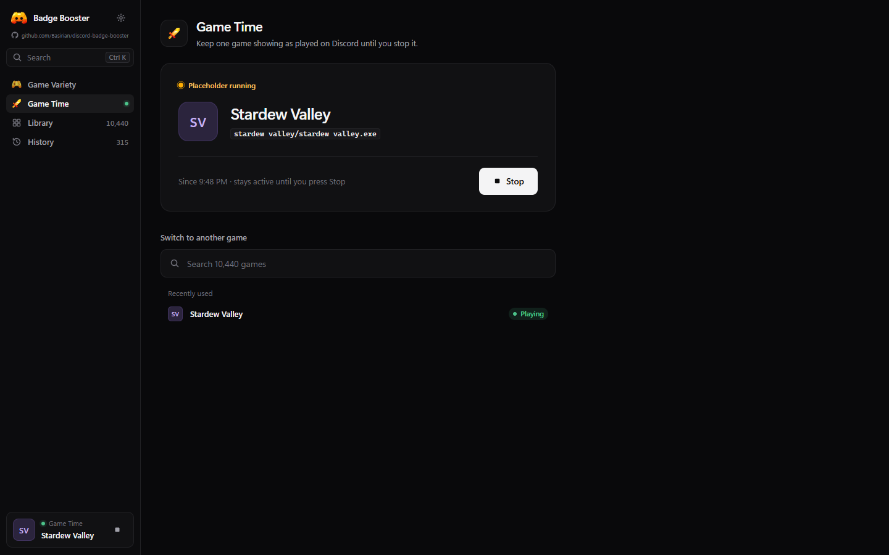
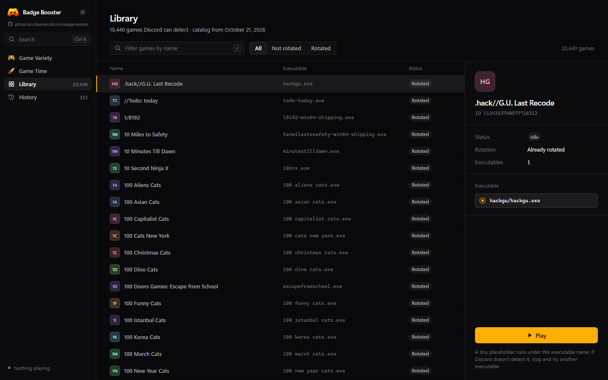
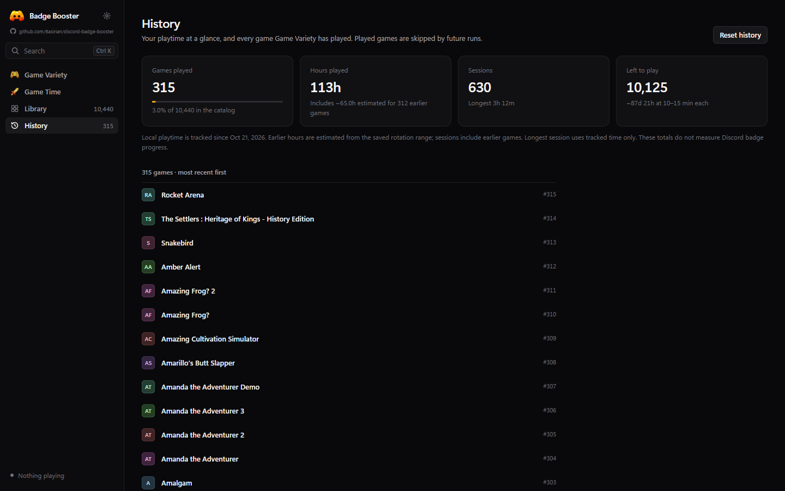

<div align="center">
  
  <h1>Badge Booster</h1>
  <p>Explore Discord game activity with automatic rotation and Game Time.<br>No Discord token. No Discord API calls. One Windows executable.</p>
  <p>
    <a href="https://github.com/Basirian/discord-badge-booster/releases/latest"></a>
    
    <a href="LICENSE"></a>
    <a href="https://github.com/Basirian/discord-badge-booster/stargazers"></a>
    
  </p>
  <h3><a href="https://github.com/Basirian/discord-badge-booster/releases/latest">Download BadgeBooster.exe →</a></h3>
  <p>No installer or administrator access required.</p>
</div>

> Discord recognition and badge progress are unverified. Badge Booster cannot guarantee a badge or freedom from account penalties. Its timers measure local process runtime.

## See it in action

Screenshots use simulated preview data, not verified Discord activity or badge progress.

### Game Variety
Rotate games for a random duration within your chosen range, skipping games already in rotation history.



### Game Time
Keep one selected game's placeholder active until you stop it.



### Library
Search a bundled catalog of 10,440 games and choose an executable variant.



### History
See rotation history and locally tracked playtime. Earlier hours, when available, are clearly labeled estimates.



## Features

- **Game Variety:** random or alphabetical rotation, 1 minute to 24 hours per game, with a fresh duration for every game.
- **Game Time:** keep a single game's placeholder active until stopped.
- **Searchable library:** executable variants and an optional rotation pool based on your search.
- **Persistent history:** avoid rotation repeats across restarts; reset history whenever you choose.
- **Local stats:** hours, sessions, and estimated time for records created before tracking existed.
- **Desktop interface:** black surfaces, amber accents, keyboard shortcuts, and one distributable exe.
- **Local operation:** no Discord login, token, analytics, or application update service.

## Why Badge Booster?

Token-based tools vary. This compares mechanisms, not the safety or effectiveness of every other project.

| | Badge Booster | Token-based analytics tools |
| --- | --- | --- |
| Discord token required | No | Typically yes |
| Sends forged Discord analytics events | No | Yes, when using that mechanism |
| Mechanism | Local placeholder for Discord's normal detection | Requests to Discord endpoints |
| Interface | Desktop GUI | Varies |
| Distribution | Single Windows exe | Varies |
| Instant hours or guaranteed badges | No | Claims are not verified here |

## Quick start

1. Download **BadgeBooster.exe** from [the latest release](https://github.com/Basirian/discord-badge-booster/releases/latest).
2. Open it on Windows x64 with .NET Framework 4.8 and the [Microsoft Edge WebView2 Runtime](https://developer.microsoft.com/microsoft-edge/webview2/). These are commonly present on Windows 11.
3. Keep Discord desktop open. Enable activity sharing if you want visible activity.
4. Choose **Game Time**, search for a game, select a variant, and click **Play**. Or start **Game Variety** for automatic rotation.
5. Check Discord's **User Settings → Registered Games** and your profile to see whether Discord recognizes it. Stop and try another variant if needed.
6. Click **Stop** or close Badge Booster to end the placeholder.

Game Variety and Game Time run one at a time. Manual sessions do not add games to rotation history. A rotation stops if three games in a row fail to start.

## FAQ

**Will I get a Discord badge?**

There is no guarantee. Discord decides recognition, eligibility, and progress. Some games need more than an executable name. Manually adding or renaming an app does not prove verified recognition or badge credit. The app cannot read your badge progress.

**Why does Windows SmartScreen show a warning?**

The exe is unsigned and may have little download reputation. Review the source and release SHA-256, or build it yourself. A checksum confirms that a download matches the release; it does not prove software is safe.

**Is it safe for my account?**

No credentials are requested and no Discord API calls are made by the app. This does not guarantee account safety or compliance with Discord's terms. Simulated activity may violate applicable rules.

**Does it download or run the actual game?**

No. It copies its own inert placeholder under a game's executable name. No game binary is downloaded or modified.

**Why are earlier hours estimated?**

Old history only stored game IDs. On first migration, the app estimates duration from the midpoint of the saved rotation range. Those hours are not measured and do not establish Discord credit. Sessions include earlier records; longest session uses tracked time only.

**How do I uninstall it?**

Close the app, delete the exe, and optionally delete `%LOCALAPPDATA%\BadgeBooster` to remove settings, history, and placeholder copies. There are no installed services, startup entries, or scheduled tasks.

## Privacy and behavior

The app does not read tokens, passwords, cookies, Discord account files, browser profiles, or machine identifiers. It makes no outbound requests during normal operation. Clicking the GitHub link opens your default browser.

The UI is embedded and loads local resources. WebView2 background networking, sync, and autofill are disabled; the Microsoft runtime is maintained separately by Windows/Edge. Discord itself may collect telemetry about detected processes.

| Local path under `%LOCALAPPDATA%\BadgeBooster` | Purpose |
| --- | --- |
| `games/` | Placeholder copies |
| `rotation-history.txt` | IDs started by Game Variety |
| `settings.txt` | Rotation preferences |
| `stats.txt` | Playtime and migration estimates |
| `webview/` | WebView2 profile and recent selections |
| `runtime/<hash>/` | Embedded Microsoft loader |

The catalog is a data snapshot of Discord's public [detectable games catalog](https://cdn.discordapp.com/detectables/games.json). Only the placeholder started by this launcher is stopped. Executable paths are checked for traversal, reserved names, and junctions/symlinks. Different existing files are never overwritten. The placeholder exits when its parent launcher terminates. Data from `%LOCALAPPDATA%\DiscordLocalGame` is migrated when no current data folder exists.

## Build from source

On Windows x64, open **Windows PowerShell** in the project folder:

```powershell
powershell -NoProfile -ExecutionPolicy Bypass -File .\build.ps1
powershell -NoProfile -ExecutionPolicy Bypass -File .\tests\verify.ps1
powershell -NoProfile -ExecutionPolicy Bypass -File .\tests\render-preview.ps1
```

The build uses the .NET Framework C# compiler. Its first run downloads WebView2 SDK **1.0.2903.40**, verifies a pinned SHA-256, and caches it in `packages/` for offline builds. The result is `dist/BadgeBooster.exe`, with the SDK, catalog, UI, and placeholder embedded. Building does not run the app. The execution policy flag applies only to that PowerShell process.

Verification checks catalog paths, overwrite protection, and placeholder lifecycle using a neutral process name. The preview script captures an idle window without starting a game. Discord recognition and badge credit are not tested.

For interface development, serve the project locally and open `/ui/index.html`. Outside the app it uses an in-browser mock. `?demo=auto`, `?demo=manual`, and `?demo=complete` show sample states without launching processes. Keep launcher changes compatible with C# 5 / .NET Framework.

## Contribute

See [CONTRIBUTING.md](CONTRIBUTING.md) for development and [SECURITY.md](SECURITY.md) for vulnerability reports. Honest reports of games that Discord does and does not recognize are welcome.

If this is useful, **[star the repository](https://github.com/Basirian/discord-badge-booster)** so others can find it.

## License and disclaimer

Original source is under the [MIT License](LICENSE). Third-party components, catalog data, and trademarks retain their respective rights; see [THIRD_PARTY_NOTICES.md](THIRD_PARTY_NOTICES.md).

Independent project, not affiliated with or endorsed by Discord. Simulated activity may violate Discord's terms or other rules. No badge, recognition, eligibility, or account safety is promised.
